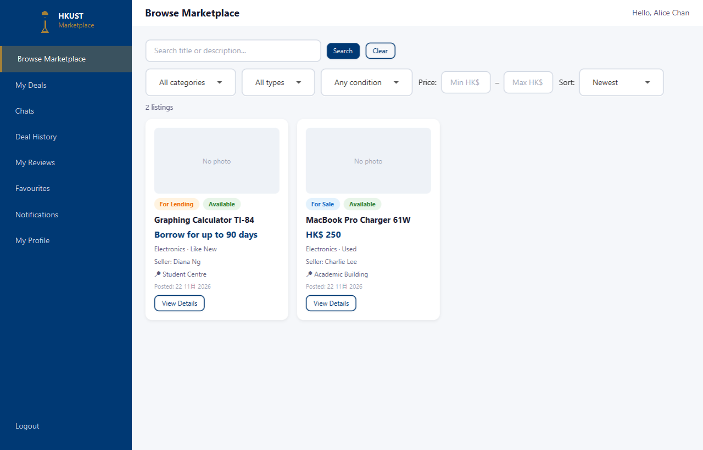
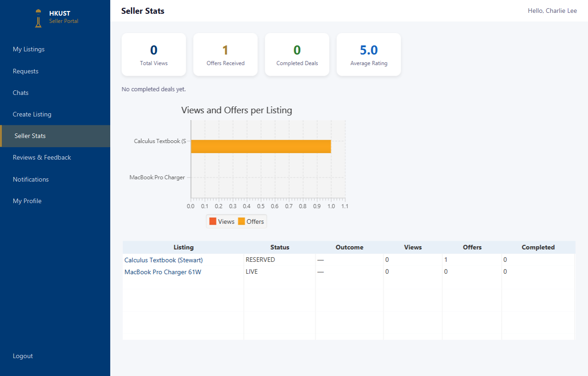
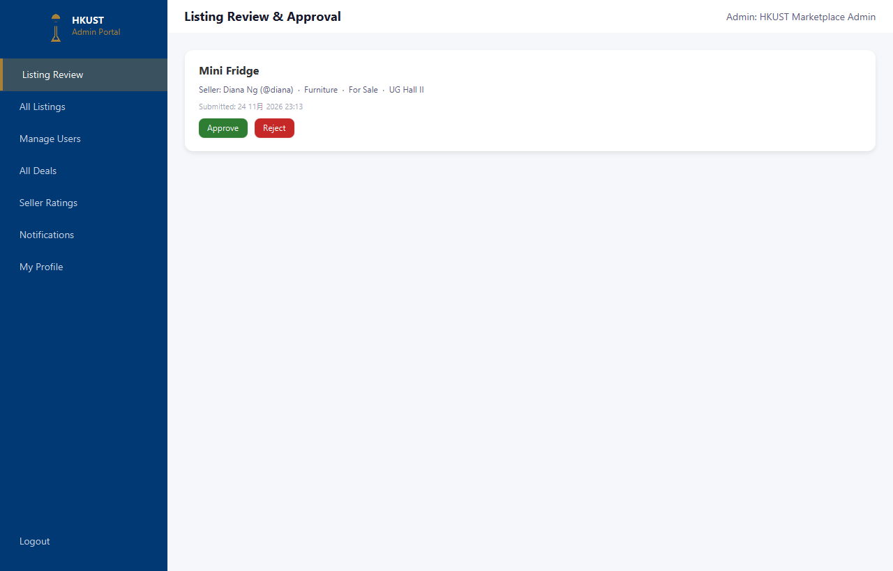

# HKUST Marketplace — JavaFX Demo

A **JavaFX + Maven** desktop demo of the HKUST Campus Marketplace platform.  
Data is stored in a local **SQLite** database (`data/marketplace.db`, kept across restarts; see [Database](#database)). Buyer, Seller and Admin portals are implemented end to end against the local stores: accounts and login, listings and moderation, offers/borrow/claims and deals, chats, reviews, notifications, seller stats and profiles. There is no network backend.

## Prerequisites

1. **JDK 21 or newer** (full JDK, not only JRE). The course requires JDK 21+.
   - Download: https://adoptium.net/ (Temurin 21 recommended)
   - After install, open a **new** PowerShell and check:
     ```powershell
     java -version
     javac -version
     ```
   - Both commands must work. If `javac` is missing, you only have a JRE — install the JDK.

2. **Maven is optional** — this project includes the **Maven Wrapper** (`mvnw.cmd` on Windows, `mvnw` on macOS/Linux).

> **Always start the app through Maven (`javafx:run`).** Running `MarketplaceApp.java` directly
> (right-click → Run in an IDE) fails with *"JavaFX runtime components are missing"*: JavaFX must
> be loaded as modules, which the Maven JavaFX plugin sets up for you.

## How to Run (Windows)

Open **PowerShell** or **Command Prompt** in the project folder  
(`...\HKUST-Marketplace-G01`):

```powershell
.\mvnw.cmd clean javafx:run
```

First run downloads Maven automatically (needs internet). Then the app window should open.

### macOS / Linux

```bash
./mvnw clean javafx:run
```

### Alternative: if you already installed Maven and added it to PATH

```powershell
mvn clean javafx:run
```

### Run from IntelliJ IDEA

1. **File → Open** the project folder; IntelliJ imports it as a Maven project. Wait for the dependencies to download.
2. Open the **Maven** tool window (right-hand side) → **marketplace → Plugins → javafx → `javafx:run`** and double-click it.
3. To rerun with one click: **Run → Edit Configurations → + → Maven**, set *Command line* to `clean javafx:run`, and save. It then appears in the Run menu and toolbar.

Do not right-click `MarketplaceApp.java` → Run; see the note under Prerequisites.

### Run from VS Code

1. Install **Extension Pack for Java**
2. Open the folder
3. In a terminal, run `.\mvnw.cmd javafx:run` (Windows) or `./mvnw javafx:run` (macOS/Linux), or use the **Maven** sidebar → **Plugins → javafx → run**.

Leave out `clean` in VS Code: its Java extension rebuilds `target/classes` as soon as `clean` deletes it, and the two compilers' files mixing can make the running app fail with `NoClassDefFoundError`.

## Demo Credentials

| Role   | Username  | Password   |
|--------|-----------|------------|
| Admin  | `admin`   | `admin123` |
| Buyer  | `alice`   | `password1`|
| Buyer  | `bob`     | `password1`|
| Seller | `charlie` | `password1`|
| Seller | `diana`   | `password1`|

## Database

The app uses a local **SQLite** file database through `sqlite-jdbc` (a normal Maven dependency, so there is nothing to install or configure).

- **File:** `data/marketplace.db`, relative to the folder you run the app from. It is created and filled with the demo data on first run. `data/` is git-ignored and must not be included in the submission ZIP.
- **Schema:** [`src/main/resources/db/schema.sql`](src/main/resources/db/schema.sql), applied on every start (`CREATE TABLE IF NOT EXISTS`). Open the file with [DB Browser for SQLite](https://sqlitebrowser.org/) or `sqlite3` to inspect it.
- **How it works:** each store (`users()`, `listings()`, ...) keeps its objects in memory, writes every change to the database straight away, and reads everything back once at startup (`persistence/Database`, `utils/DummyDataService`).
- **What is saved:** everything — users, listings (with their photo paths), deal requests and deals, favourites and follows, chat threads and messages, notifications, reviews, listing reports and the admin audit log. Data is **kept across restarts**.
- **Reset to the demo data:** quit the app and delete the `data/` folder; the next launch creates a fresh database with the demo data.
- **Changing the schema:** `CREATE TABLE IF NOT EXISTS` does not alter existing tables, so after changing a table in `schema.sql`, delete `data/` (or reset as above) to recreate it.
- **One-time reset for the hidden flag:** listings now persist a `deleted` visibility column (`0` = visible, `1` = hidden). A database created before this column existed will not gain it from `CREATE TABLE IF NOT EXISTS`, so delete `data/` once (or reset as above) after pulling this change. The first launch afterwards recreates the schema with the column; no further reset is needed and data is kept across restarts as usual.
- **Tests** use a private in-memory SQLite database per `new DummyDataService()`, so they never touch `data/`.
- **One running copy at a time.** The app keeps its data in memory and writes every change to the database, so two copies on the same `data/` would not see each other's changes and could overwrite them. The app therefore locks `data/marketplace.db.lock` while it runs; starting a second copy shows *"HKUST Marketplace is already running"* and exits without touching the data. The operating system releases the lock when the app closes or crashes. Delete or reset `data/` only while the app is closed: deleting it under a running app removes the lock file too, so the protection no longer holds.
- **Switching user / demoing two users:** log out and log in as the other user in the same window; everything they did is already there.
- **Concurrent actions** (e.g. two buyers claiming the same giveaway) are handled inside the app: requests go through one synchronized `DealLifecycle`, so only the first claim wins and later ones are told *"someone else has already claimed this item"*. `DealRequestServiceTest.onlyOneOfManySimultaneousClaimsWins` runs eight claims at the same moment and checks exactly one succeeds.

**Team rule:** screens never change a model object and skip the store. Every change goes through a store method, e.g. `listings().update(listing)` after changing a listing or `users().save(user)` after changing an account, so it is written to the database. Requests and deals change only through `deals().lifecycle()`, which saves them (and the listing status they set) itself. **Deleting a listing is a soft delete** (`SellerService.deleteListing`): it declines any pending or countered offers, notifies their buyers, and sets the `deleted` flag via `listings().update(listing)` — the row is kept so chat, deal history and notification links still resolve it. Hidden listings are omitted from Browse/Search, favourites, My Listings, admin lists and seller counts; never remove a listing row from a seller screen.

**Role checks (#60):** admin-only and seller-only actions live in `AdminService` and `SellerService`. Each method takes the acting user (`SessionManager.getCurrentUser()`) and calls `AccessControl.require(actor, role)` first, which throws `SecurityException` for the wrong role or an inactive account. New role-specific actions should follow the same pattern (`ChatService` already does for chat participants), so the check holds even if a screen shows a button it shouldn't.

## Tests and Coverage

```powershell
.\mvnw.cmd test
```

- JUnit 5 tests cover the models and services (stores, deal lifecycle, chat, reviews, notifications, admin actions, profile, seller stats) plus the database layer. Screen tests open the buyer, seller and admin portals, the login and registration screens and the chat view, and click through them like a user; they need a display and are skipped without one.
- Tests use an in-memory SQLite database (`Database.inMemory()` or a private `DummyDataService`), so they never create or read `data/marketplace.db`.
- JaCoCo writes the coverage report to `target/site/jacoco/index.html` (CSV: `target/site/jacoco/jacoco.csv`) during the same `test` run.
- Latest run: **665 tests, 0 failures**. Branch coverage **76.2%** and line coverage **84.9%** over every package, including the JavaFX controllers (89.0% branch on the business logic alone). Committed reports: [`docs/reports/unit-tests.md`](docs/reports/unit-tests.md) and [`docs/reports/coverage/index.html`](docs/reports/coverage/index.html).
- API documentation: `.\mvnw.cmd javadoc:javadoc` writes HTML to `target/reports/apidocs/index.html`. A committed copy is at [`docs/javadoc/index.html`](docs/javadoc/index.html).
- Demo script: [`docs/DEMO.md`](docs/DEMO.md). Supplementary notes for grading: [`docs/SUPPLEMENTARY.md`](docs/SUPPLEMENTARY.md).

## Security State (Demo)

- Passwords are stored only as **BCrypt hashes** (jBCrypt, cost factor 12), produced by `PasswordHasher`. `User.passwordHash` is the only credential field; plaintext passwords are never stored in a `User`, logged, or compared directly. Seeding hashes the demo passwords at startup, buyer/seller registration hashes the chosen password, and every login verifies through `PasswordHasher.verify`.
- Buyer and Seller registration enforces the full UC-1.1 A3 password rules through `UserStore.checkPasswordStrength(password, username)`:
  - 8 to 64 characters.
  - At least one uppercase letter, one lowercase letter, one digit and one special character.
  - No spaces.
  - Not equal to the username (case-insensitive).
  - The check returns a set of `PasswordRule` values naming **every** broken rule, so the form can tell the user what to fix instead of failing on the first problem.
- Deactivated accounts (`active = false`) are refused at the login gate of all three portals with an explicit account-deactivated message. The Admin dashboard's activate/deactivate toggle flips the same flag.
- Portal access checks also run in the service layer: `AdminService` and `SellerService` call `AccessControl.require` before every change, so a wrong-role call fails even if a screen offered the action. These are in-process checks; the demo has no network backend or session tokens.

> **Demo-only credentials:** `admin / admin123` and the buyer/seller accounts use `password1`. These are hashed at seed time like any other credential, and they exist solely for the demo walkthrough — they bypass registration validation and must not be reused in a real deployment.

## Screenshots

Every screen per portal is in [`docs/screenshots/`](docs/screenshots). The images were rendered from the FXML views with the seeded demo data.

| Portal | Screens |
|--------|---------|
| Shared | [Welcome](docs/screenshots/welcome.png) |
| Buyer | [Login](docs/screenshots/buyer-login.png) · [Register](docs/screenshots/buyer-register.png) · [Browse](docs/screenshots/buyer-browse.png) · [My Deals](docs/screenshots/buyer-my-deals.png) · [Deal History](docs/screenshots/buyer-history.png) · [Favourites & Following](docs/screenshots/buyer-favourites.png) · [Chats](docs/screenshots/buyer-chats.png) · [My Reviews](docs/screenshots/buyer-reviews.png) · [Notifications](docs/screenshots/buyer-notifications.png) · [Profile](docs/screenshots/buyer-profile.png) |
| Seller | [Login](docs/screenshots/seller-login.png) · [Register](docs/screenshots/seller-register.png) · [My Listings](docs/screenshots/seller-my-listings.png) · [Requests](docs/screenshots/seller-requests.png) · [Create Listing](docs/screenshots/seller-create-listing.png) · [Chats](docs/screenshots/seller-chats.png) · [Seller Stats](docs/screenshots/seller-stats.png) · [Reviews & Feedback](docs/screenshots/seller-reviews.png) · [Notifications](docs/screenshots/seller-notifications.png) · [Profile](docs/screenshots/seller-profile.png) |
| Admin | [Login](docs/screenshots/admin-login.png) · [Listing Review](docs/screenshots/admin-review.png) · [All Listings](docs/screenshots/admin-all-listings.png) · [Manage Users](docs/screenshots/admin-users.png) · [All Deals](docs/screenshots/admin-deals.png) · [Seller Ratings](docs/screenshots/admin-ratings.png) · [Notifications](docs/screenshots/admin-notifications.png) · [Profile](docs/screenshots/admin-profile.png) |

**Buyer browse**



**Seller stats**



**Admin listing review**



## Features Implemented (Demo)

All state is reached through `DummyDataService` and its per-area stores, backed by SQLite (see [Database](#database)).

### Shared
- Abstract `User` base with `Buyer` / `Seller` / `Admin` subtypes; each account holds exactly one fixed role, and usernames are unique across all roles
- BCrypt-hashed credentials and a shared login gate that refuses wrong-portal and deactivated accounts on every portal
- Seller ratings derived from non-hidden reviews; "No rating yet" is shown when no visible reviews exist
- Welcome screen with role selection (Buyer / Seller / Admin)
- HKUST branding (logo + colour palette: deep blue `#003974` + gold `#A68137`)
- Modern card-based UI with the HKUST palette and consistent sidebars and top bars
- Local SQLite database with seeded demo data (no server, no network)

### Buyer Portal
- Registration, Login, Browse Marketplace with search, filters and sort
- Make a price offer, borrow request or giveaway claim on a listing
- My Deals (accept/decline counters, mark returned/completed), Deal History with filters, Favourites
- Chats with sellers, reviews for completed deals, notifications, profile

### Seller Portal
- Registration, Login, Create Listing (sale / lend / giveaway, up to six photos)
- My Listings: edit, mark sold, soft-delete; Requests: accept, decline, counter price or borrow period
- Seller Stats (views, offers, completed deals, per-listing chart), Reviews & Feedback with seller reply
- Chats with buyers, notifications, profile

### Admin Portal
- Login (seeded), Listing Review (approve/reject), All Listings (edit, take down, add on behalf, resolve reports)
- Manage Users (add, edit, activate/deactivate, soft-delete), All Deals, Seller Ratings (hide flagged reviews)
- Notifications, profile, and an audit log recording admin actions

## Submission Evidence

| Required item | Where it is |
| --- | --- |
| Screenshots of execution | [`docs/screenshots/`](docs/screenshots/) (every screen, seeded demo data) |
| Unit test report (100% pass) | [`docs/reports/unit-tests.md`](docs/reports/unit-tests.md) — 665 tests, 0 failures |
| Coverage report (>65% branch) | [`docs/reports/coverage.md`](docs/reports/coverage.md) and [`docs/reports/coverage/index.html`](docs/reports/coverage/index.html) — 76.2% branch, controllers included |
| JavaDoc | [`docs/javadoc/index.html`](docs/javadoc/index.html) |
| Supplementary notes / demo guide | [`docs/SUPPLEMENTARY.md`](docs/SUPPLEMENTARY.md), [`docs/DEMO.md`](docs/DEMO.md) |

## Project Structure

```
HKUST-Marketplace/
├── mvnw / mvnw.cmd          ← Maven Wrapper (use these!)
├── pom.xml
├── README.md
└── src/main/
    ├── java/com/hkust/marketplace/
    │   ├── MarketplaceApp.java
    │   ├── controllers/
    │   ├── models/
    │   ├── persistence/     ← SQLite connection (Database)
    │   └── utils/           ← per-area stores, DummyDataService
    └── resources/
        ├── db/schema.sql    ← database schema
        ├── fxml/
        ├── css/styles.css
        └── images/hkust_logo.png
docs/screenshots/            ← one PNG per screen, per portal
```

## Troubleshooting

### `mvn` is not recognized
Use the wrapper instead:
```powershell
.\mvnw.cmd clean javafx:run
```

### `java` / `javac` not recognized
Install JDK 21+ from https://adoptium.net/ and **restart the terminal**.  
Make sure the installer option “Add to PATH” was checked.

### Build fails with JavaFX / DISPLAY errors
You need a normal desktop session (not a headless server). On Windows this is usually fine.

### To see the real error
```powershell
.\mvnw.cmd clean javafx:run -e
```
Copy the lines that start with `Exception in thread` or `Caused by`.

## Next Steps (Backend)

1. All stores already persist to SQLite and data survives restarts (#56–#59). A real deployment would still move this to a server API.
2. Replace the in-memory `SessionManager` with session tokens and network-level authentication; the in-process `AccessControl` checks are the current guard.
3. Replace the local photo folder with real upload storage; files currently go to `data/photos/` and their relative paths are saved in `listing_photos`.
4. Add the remaining platform features that need a backend, such as push notifications and payment.

## Licence

Educational use — HKUST COMP project skeleton.
